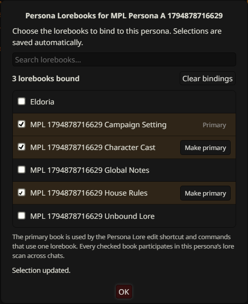

# Multiple Persona Lorebooks

A SillyTavern extension that lets each persona bind multiple lorebooks. It adds a searchable checkbox picker to the native **Persona Lore** dialog and feeds additional books into SillyTavern's normal World Info scanner.

Requires **SillyTavern 1.19.0 or newer**. No SillyTavern core files are modified.

## Installation

1. In SillyTavern, open **Extensions → Install extension**.
2. Paste this repository URL:

   ```text
   https://github.com/xyzzy121/SillyTavern-MultiPersonaLore
   ```

3. Install and reload the page.

For manual installation, place the repository folder in either of these locations relative to your SillyTavern installation or configured data directory:

```text
public/scripts/extensions/third-party/SillyTavern-MultiPersonaLore/
data/<user-handle>/extensions/SillyTavern-MultiPersonaLore/
```

The folder must directly contain `manifest.json`, `index.js`, `lore.js`, and `style.css`.

## Usage

1. Select a named persona in **Persona Management**.
2. Open **Persona Lore**. If a primary book is already bound, **Shift-click** or **Alt-click** the button; on mobile, **long-press** it. An ordinary click opens the primary book in the World Info editor.
3. Check the books to bind. Search filters the list without changing the selection.
4. Use **Make primary** to choose the book opened by the edit shortcut, or **Clear bindings** to remove all bindings for this persona.

The first selection becomes primary. Unchecking the primary promotes the next selected book. The button shows a count when more than one book is bound. Bindings follow the selected persona across characters, individual chats, and group chats.

Changes use SillyTavern's normal settings save. “Selection updated” means the selection was updated and a save was requested; SillyTavern reports persistence failures through its own notifications. Resolve any host save error before leaving or reloading.



## Behavior and compatibility

- The primary remains in SillyTavern's native string fields. Extras are stored as `multi_persona_lorebooks: { version: 1, books: [...] }` on that persona's descriptor. Global World Info selections are unchanged.
- Native persona backups include extras. Restore follows SillyTavern's normal merge behavior, which skips personas already present. Duplicating a persona while this extension is enabled copies its extra bindings; deleting a persona removes them.
- Entries enter the native scan before sorting, decorators, hashes, activation, and budget processing. Keywords, disabled entries, recursion, and World Info budgets continue to apply. Binding a book does not force every entry to activate.
- Books already active globally keep their native global source. Chat-bound books take chat precedence; overlapping character books take persona precedence. Entries are not added twice by this extension.
- Works with [Multiple Chat Lorebooks](https://github.com/xyzzy121/SillyTavern-MultiChatLore), including overlapping bindings and either extension activation order.
- Native `/getpersonabook`, `/persona-get`, and tools expecting one persona book continue to use the **primary** book. A native command that changes the primary leaves this extension's extra bindings in place.
- Disabling or removing the extension keeps saved bindings. The native primary remains active; additional books become active again when the extension is enabled.
- Renamed or deleted additional books appear as **Missing**. Uncheck the old name and select its replacement. Missing or unreadable books are skipped without erasing their bindings or blocking valid books.
- A popup left open when the persona changes disables its controls. Close it and reopen Persona Lore for the current persona.

## Development and validation

The extension has no build step or runtime dependencies. Run focused tests with Node.js:

```sh
npm test
node --check index.js
node --check lore.js
```

See [VALIDATION.md](VALIDATION.md) for recorded results and [tests/README.md](tests/README.md) for the browser integration harness. Browser tests require a separate disposable SillyTavern server; they create and delete test personas, chats, groups, and lorebooks.

## License and acknowledgments

MIT. See [LICENSE](LICENSE).

Adapted from [SillyTavern-MultiChatLore](https://github.com/xyzzy121/SillyTavern-MultiChatLore), copyright 2026 Paradox. This extension uses the same native primary-book compatibility approach for persona bindings.
